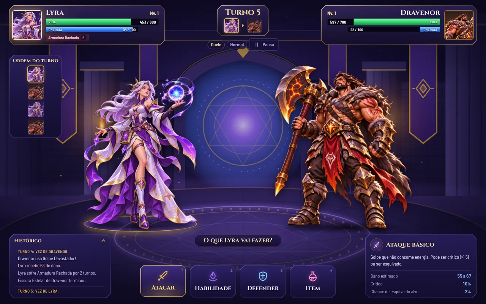
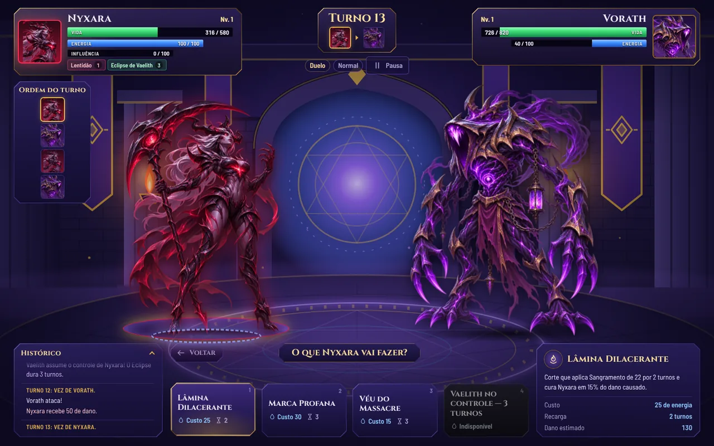
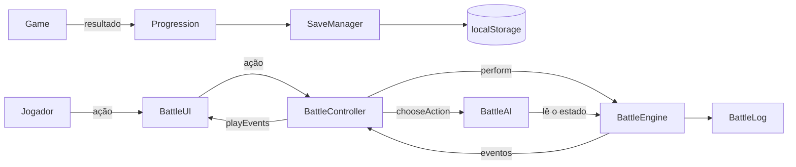
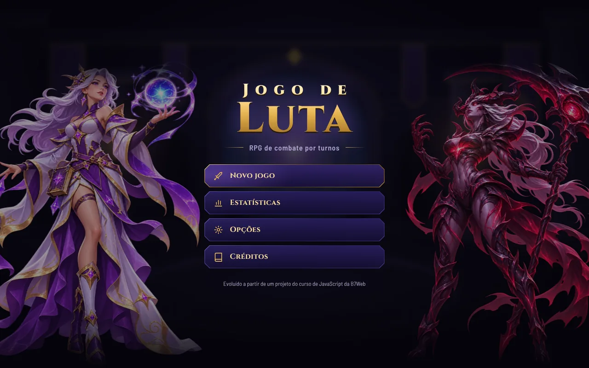
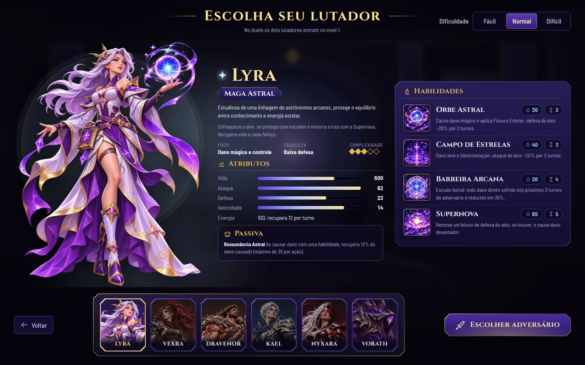
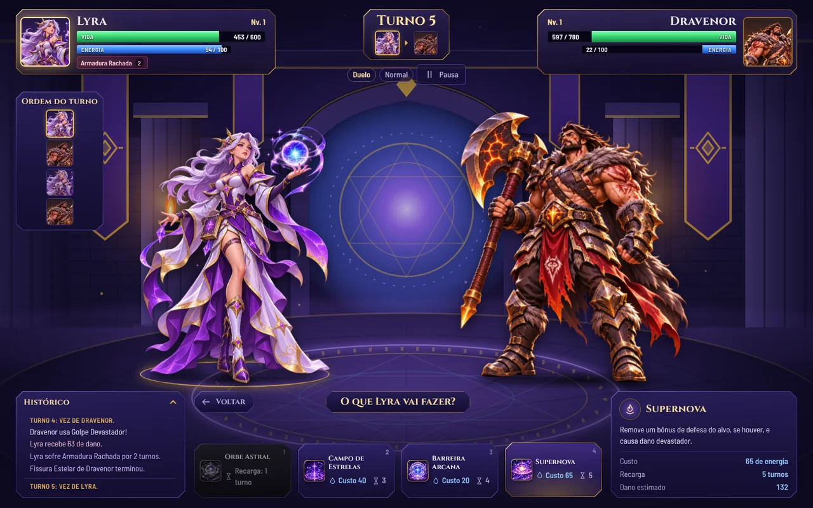
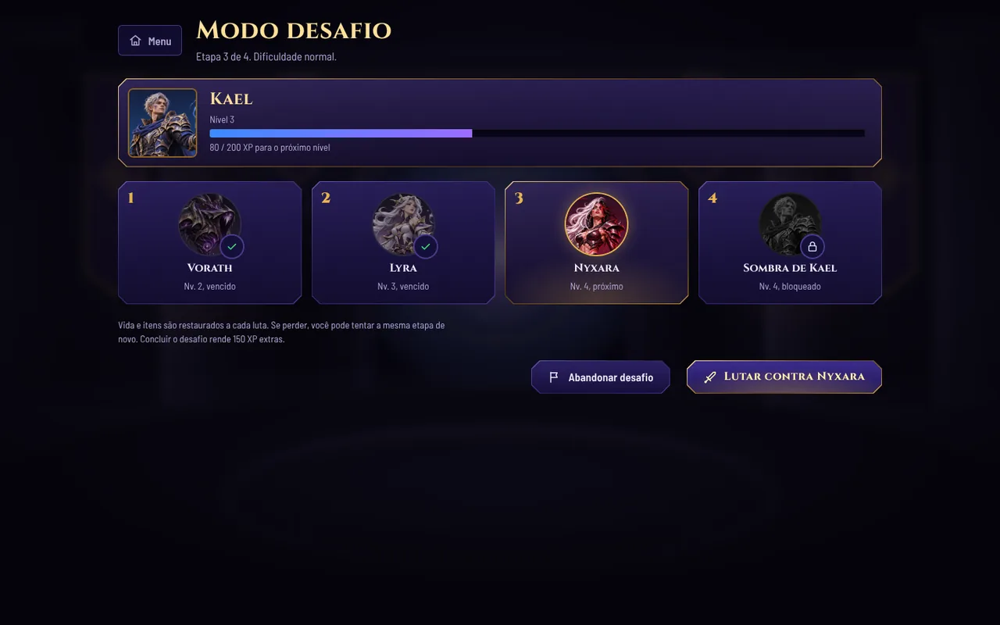
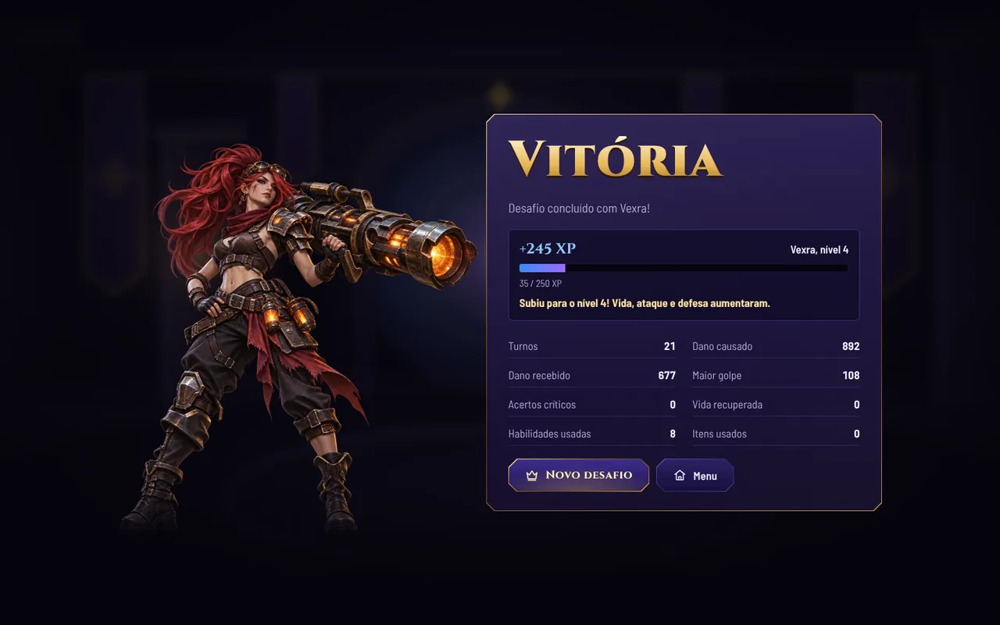
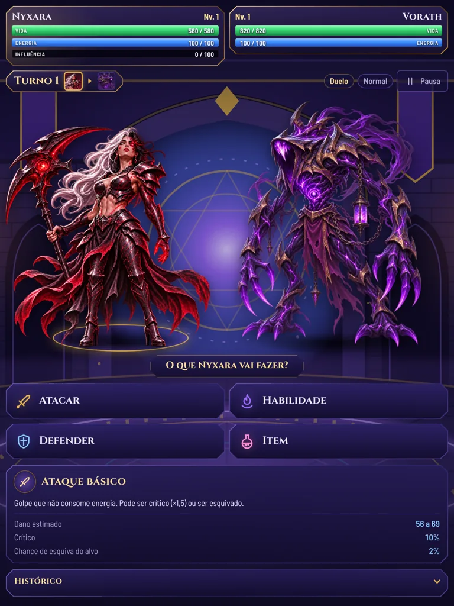
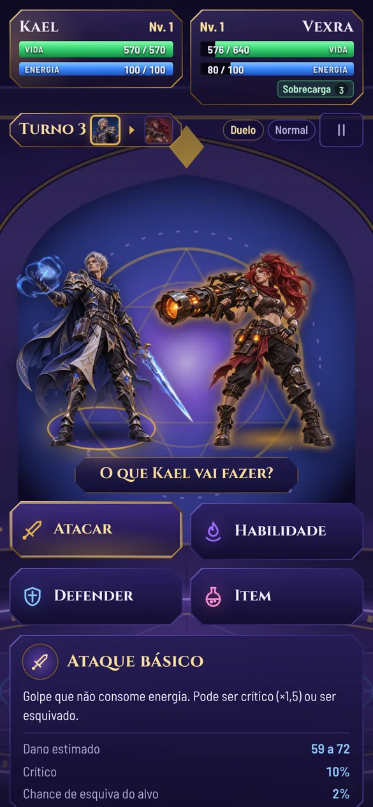

# Jogo de Luta: RPG por turnos

RPG de combate por turnos para navegador, escrito em TypeScript puro (sem frameworks de interface).

- Seis personagens originais, cada um com passiva e quatro habilidades.
- Efeitos temporários e uma transformação de combate (o Eclipse da Nyxara).
- Inteligência artificial em três dificuldades.
- Modo desafio com progressão e salvamento local.



## Sobre o projeto

O projeto nasceu no **curso de JavaScript da [B7Web](https://b7web.com.br)**, como exercício de Programação Orientada a Objetos: quatro personagens com vida, ataque e defesa, uma barra de vida e um botão de ataque.

Depois foi reescrito e ampliado para aprofundar **TypeScript, orientação a objetos e desenvolvimento de jogos**. Ganhou turnos, habilidades, IA, progressão, testes automatizados e uma interface nova. Na versão atual, os lutadores do curso deram lugar a um elenco original de seis personagens, especificado no documento de design *Arena RPG: Personagens e Balanceamento*.

## Personagens

| Personagem | Classe | Foco | Fraqueza | Complexidade |
| --- | --- | --- | --- | :---: |
| Lyra | Maga Astral | Dano mágico e controle | Baixa defesa | 3/5 |
| Vexra | Atiradora Mecânica | Pressão e dano continuado | Pouca sustentação | 3/5 |
| Dravenor | Guerreiro Bestial | Resistência e regeneração | Baixa velocidade | 2/5 |
| Kael | Duelista Arcano | Mobilidade e contra-ataque | Pouca vida | 4/5 |
| Nyxara | Portadora do Eclipse | Sangramento e transformação | Defesa frágil; gestão da influência | 5/5 |
| Vorath | Colosso Abissal | Absorção e controle | Lento; dano direto baixo | 3/5 |

Cada passiva é uma regra real do motor de combate, não apenas um texto na interface:

- **Lyra, Ressonância Astral**: cura 12% do dano de cada habilidade, até 35 por ação.
- **Vexra, Mecanismo Aquecido**: o segundo ataque básico seguido causa +15%.
- **Dravenor, Vigor Ancestral**: abaixo de 45% de vida, cura 16 no início do turno, depois do dano contínuo.
- **Kael, Leitura de Combate**: depois de uma esquiva, o próximo básico causa +20%.
- **Nyxara, Corrupção do Eclipse**: medidor de influência de 0 a 100 que libera a transformação.
- **Vorath, Núcleo Voraz**: cura 10 no início do turno se sofreu dano desde o turno anterior.

### A transformação da Nyxara



A influência sobe ao causar dano direto (+15 por ação), ao sofrer dano direto (+10 por ação inimiga), ao usar habilidades normais (+10) e quando o Véu Espectral faz Nyxara esquivar (+20). Não sobe com golpes múltiplos nem com dano periódico. Com 100, o **Eclipse de Vaelith** fica disponível e então:

- **A personagem continua a mesma.** Não existe segunda instância: vida, energia, efeitos, itens e posição na arena permanecem.
- **Atributos mudam** por 3 turnos próprios completos (o turno da ativação não conta): ataque +30%, velocidade +10%, defesa −15%.
- **As habilidades viram as versões bestiais**: Lâmina Dilacerante, Marca Profana e Véu do Massacre. As versões normais e bestiais compartilham o id, então trocar de forma não zera recargas.
- **A Ultimate mostra "Vaelith no controle — X turnos"** e fica bloqueada. A recarga de 5 turnos só começa quando Nyxara retoma o controle, e a influência não cresce durante a transformação.
- **Não há transformação simultânea**: com o Eclipse ativo a Ultimate fica bloqueada, e depois do retorno a recarga vale mesmo com a influência cheia. Se a luta acaba durante o Eclipse, a batalha termina normalmente e o próximo combate começa na forma normal.
- **A IA entende a mecânica**: só usa a Ultimate com influência 100 e evita atacar quando o Véu do Massacre ameaça um revide.

## Funcionalidades

- **Combate por turnos**: atacar, defender, usar habilidades ou itens, com uma ação por turno. O mais veloz começa; depois os lados se alternam.
- **Mecânicas**:
  - acertos críticos, esquiva por velocidade e variação moderada de dano;
  - dano contínuo (queimadura e sangramento), atordoamento, buffs e debuffs;
  - escudo de dano, esquiva ampliada, revide (ao ser atingido ou ao esquivar), torre automática e remoção de bônus.
- **Itens** limitados por luta: Poção de Vida, Elixir de Energia e Tônico de Força (um de cada).
- **IA baseada em regras** em três dificuldades, sem modelos generativos nem APIs externas. A dificuldade muda a qualidade das decisões, não os atributos.
  - A IA avalia cada habilidade pelos metadados de efeitos, então funciona para qualquer personagem.
  - Ela lê o estado do combate: quanto a luta ainda deve durar, o maior golpe que o adversário pode dar e a energia disponível.
  - Com isso, usa bônus antes dos golpes fortes, defesas contra ameaças reais, o elixir quando ele libera uma habilidade e a cura quando a derrota está próxima.
  - No fácil, a IA não planeja: avalia só a próxima ação.
- **Modo desafio**: três adversários sorteados e, por fim, a sua própria sombra. Inclui experiência, níveis (até o 10), evolução moderada de atributos e estatísticas.
- **Duelo**: luta avulsa com os dois lutadores no nível 1.
- **Cinco cenários**: Arena Arcana (SVG original), o ringue do projeto do curso, Ruínas Antigas, Templo do Eclipse e Dimensão Abissal (veja [`docs/cenarios.md`](docs/cenarios.md)).
- **Salvamento em `localStorage`**, com migração explícita de saves antigos.
- **Animações de combate**: investida e recuo nos golpes corpo a corpo, projéteis que saem da arma, um efeito próprio para cada habilidade, tremor de tela, pausa no crítico, poses de preparo, golpe, dano, vitória e derrota, e efeitos visíveis enquanto um estado dura (escudo, brasas, sangramento, torre, marca, lentidão, auras).
- **Efeitos sonoros**: sons próprios para as habilidades principais de cada personagem e para a transformação em Vaelith, sincronizados com o disparo, o golpe ou a explosão de cada animação, além do impacto genérico e dos sons sintetizados de menus, defesa e cura (veja [`docs/audio.md`](docs/audio.md)).
- **Opções**: volume, efeitos sonoros, animações (respeitando a preferência do sistema por movimento reduzido) e dificuldade.
- **Responsivo e acessível pelo teclado**: atalhos `1` a `4` e `Esc`; no celular, os painéis se reorganizam.

## Tecnologias

- **TypeScript** (modo estrito)
- **HTML** e **CSS** puros
- **[Vite](https://vite.dev)** para desenvolvimento e build
- **[Vitest](https://vitest.dev)** para os testes
- **Web Audio API** para efeitos sonoros sintetizados

Nenhuma biblioteca de interface ou de jogo. As únicas dependências são as ferramentas de desenvolvimento acima.

## Como instalar e executar

Pré-requisito: **Node.js 22.12 ou superior**.

```bash
git clone https://github.com/<seu-usuario>/projLuta.git
cd projLuta
npm install
npm run dev
```

### Comandos

| Comando | O que faz |
| --- | --- |
| `npm run dev` | Servidor de desenvolvimento com recarga automática |
| `npm test` | Executa todos os testes uma vez |
| `npm run test:watch` | Executa os testes em modo de observação |
| `npm run typecheck` | Verifica os tipos com o compilador do TypeScript |
| `npm run build` | Verifica os tipos e gera a versão de produção em `dist/` |
| `npm run preview` | Serve localmente a versão de produção |
| `npm run simulate -- 100 normal` | Simula IA contra IA em todos os pares e imprime o relatório de balanceamento |
| `npm run simulate -- 150 hard 1000` | O mesmo, com outro conjunto de sementes (1001 a 1150), para validar ajustes |

## Publicação no GitHub Pages

O build usa caminhos relativos (`base: './'`), então funciona em qualquer subpasta. O workflow `.github/workflows/deploy.yml` faz o seguinte a cada push na `main`:

1. roda os testes;
2. gera o build com o nome do repositório como `base`;
3. publica no GitHub Pages.

Para ativar, vá em **Settings → Pages** e escolha **GitHub Actions** como fonte.

## Arquitetura

O motor de combate não conhece o DOM. Ele recebe ações, valida, resolve e devolve uma lista de **eventos** (dano, cura, efeito aplicado, mudança de forma, medidor, fim de combate…). A interface apenas reproduz esses eventos.



```
src/
├── core/                  Regras do jogo, sem dependência do DOM
│   ├── Character.ts       Classe base: vida, energia, efeitos, recargas, formas e ganchos
│   ├── characters/        Lyra, Vexra, Dravenor, Kael, Nyxara e Vorath
│   ├── BattleEngine.ts    Turnos, validação, dano, efeitos, recursos, vitória e derrota
│   ├── BattleAI.ts        Decisões do adversário por pontuação de ações
│   ├── BattleLog.ts       Registro cronológico do combate
│   ├── damage.ts          Fórmulas puras de dano, crítico, esquiva e limites
│   ├── effects.ts         Catálogo de efeitos temporários
│   ├── items.ts           Itens e inventário limitado
│   ├── random.ts          Fontes de aleatoriedade (incluindo com semente, para testes)
│   ├── roster.ts          Fábrica de personagens
│   └── types.ts           Tipos de habilidades, ações, efeitos, eventos e resultados
├── progression/           Experiência, níveis, desafio, estatísticas, saves e opções
├── game/                  Game (navegação e persistência) e BattleController
├── ui/                    BattleUI, telas, áudio, ícones, mapa de artes (art.ts),
│                          coreografia dos golpes (choreography.ts) e efeitos (Vfx.ts)
├── styles/                CSS dividido em base, telas e batalha
└── assets/                Artes dos personagens (WebP), cenários, sons e fontes
scripts/simulate.ts        Simulação de balanceamento
tests/                     Testes do Vitest
docs/balanceamento.md      Relatório de balanceamento
docs/polimento-visual.md   Enquadramento das artes, ajustes de interface e verificação no navegador (3.3.0)
docs/animacoes.md          Animações de combate, poses e especificação das artes de pose (3.4.0)
docs/audio.md              Efeitos sonoros: arquivos, sincronização, volume e como adicionar novos (3.5.0)
docs/selecao.md            Nova seleção de personagem e ícones de habilidade (3.6.0)
docs/cenarios.md           Os cinco cenários, enquadramento e contraste (3.7.0)
assets-source/             Originais dos sons (Firefly) e da arte da torre, fora do build
```

### Regras de combate

- **Dano direto**: `round(ataque × poder × 100 / (100 + defesa) × modificadores)`.
  - Ataques básicos variam ±10%; habilidades não variam.
  - Crítico: 10% de chance, ×1,5, só em ataques básicos.
- **Esquiva**:
  - Base de 5%, +1% por ponto de velocidade a mais que o atacante, entre 2% e 20%.
  - Normalmente só ataques básicos podem ser esquivados.
  - Efeitos de esquiva ampliada (Passo Etéreo, Véus) somam 35 pontos contra o próximo ataque direto, inclusive habilidades, até 50%. São consumidos por esse ataque.
  - O Passo Etéreo revida se a esquiva funcionar; o Véu do Massacre revida se o golpe acertar.
- **Defender**: reduz em 50% o dano direto da próxima ação inimiga e recupera 15 de energia. A guarda termina no início do turno seguinte de quem defendeu.
- **Energia**: todos começam com 100 (máximo 100) e recuperam 12 no início de cada turno próprio.
- **Redução de dano**: fora da guarda, a soma das reduções de dano recebido não passa de 60%.
- **Efeitos**: a duração conta os turnos próprios de quem recebe o efeito; o turno em que ele foi criado não conta. Reaplicar o mesmo efeito renova a duração sem acumular; efeitos diferentes coexistem.
- **Atordoamento**: o alvo perde exatamente um turno.
- **Golpes múltiplos**: cada impacto conta separadamente, e o golpe para quando o alvo cai.
- **Ordem do início do turno**: a guarda termina → dano contínuo → convocações (torre) → passivas de início de turno → energia → atordoamento.
- **Ordem do fim do turno**: passivas → recargas → duração dos efeitos → mudanças de forma.

### Balanceamento

Os valores do documento de design eram provisórios. Na primeira integração, os tanques dominavam (Dravenor com 100% de vitórias). O balanceamento foi refeito em duas etapas: primeiro os atributos e, depois, uma revisão funcional da IA, das habilidades de suporte e da sustentação.

Resultado atual, com 100 combates por par:

- todos os personagens ficam entre 46% e 55% nas IAs normal e difícil;
- na IA normal, nenhum confronto fica fora da faixa de 25% a 75%;
- Dravenor × Vorath, que durava 87 turnos em média com 98% para um lado, agora dura 66 turnos, com 72%.

Diagnóstico, números de antes e depois, validação em outras sementes e pendências estão em [`docs/balanceamento.md`](docs/balanceamento.md).

### Progressão e saves

- XP por luta: `(60 + 15 × nível do adversário) × dificuldade (0,75 / 1 / 1,3)`, com +20% no desafio.
  - Derrotas rendem 25% e desistências não rendem nada.
  - Concluir o desafio rende 150 XP extras.
- Cada nível acima do 1 dá vida +6%, ataque +5% e defesa +5%; velocidade e energia não crescem.
- **Saves da versão 1** (elenco antigo) são migrados ao carregar:
  - as estatísticas gerais são mantidas;
  - níveis dos lutadores antigos e o desafio em andamento são descartados, porque aqueles personagens não existem mais;
  - o jogo avisa o jogador no menu.

## Conceitos de POO demonstrados

- **Abstração**: `Character` é abstrata; cada lutador existe como subclasse concreta.
- **Herança**: os seis personagens estendem `Character` e herdam vida, energia, efeitos e recargas.
- **Polimorfismo**: cada passiva sobrescreve ganchos que o motor chama sempre do mesmo jeito.
  - Os ganchos são `onTurnStart`, `onActionResolved`, `onDamageTaken`, `onAttacked`, `onEvasionResolved`, `outgoingDamageModifier`, `statBonus` e `onTurnFinished`.
  - A Nyxara sobrescreve também o conjunto de habilidades e os atributos conforme a forma.
  - Valores diferentes ficam em dados; subclasses existem só onde há comportamento diferente.
- **Encapsulamento**: vida, energia, efeitos, recargas e influência são privados e só mudam por métodos que garantem as regras.
- **Composição e injeção de dependências**: o motor recebe a fonte de aleatoriedade e o `SaveManager` recebe o armazenamento, o que permite testes determinísticos.
- **Interfaces e tipos**: habilidades, metadados para a IA, efeitos, ações, eventos e resultados são descritos em `types.ts`.

## Testes

```bash
npm test
```

São 103 testes em 7 arquivos, com aleatoriedade controlada:

- **Dano**: fórmula global, crítico, esquiva, defesa ignorada e teto de 60% de redução.
- **Motor**:
  - ordem dos turnos, energia e recargas;
  - guarda e duração dos efeitos;
  - atordoamento, queimadura e golpes múltiplos;
  - itens, vitória e derrota.
- **Personagens**:
  - seis personagens nos níveis 1 e 10, com ids estáveis;
  - cada passiva e as habilidades com regra própria: Barreira por 2 turnos, torre de 3 disparos sem duplicação, Sobrecarga, Duelo Perfeito, Supernova, Ruptura com chance injetada, Passo Etéreo com revide só na esquiva, Assimilação.
- **Nyxara**:
  - influência por fonte, sem contar golpes múltiplos nem dano periódico;
  - Ultimate bloqueada antes de 100;
  - transformação de 3 turnos com atributos e habilidades trocados, recargas compartilhadas e retorno;
  - sem transformação simultânea e com a recarga respeitada mesmo com influência cheia;
  - vida, energia, efeitos e recargas preservados no retorno;
  - Véu Espectral dando influência só quando a esquiva funciona;
  - derrota e vitória durante o Eclipse.
- **IA**:
  - só ações válidas com os seis personagens nas três dificuldades;
  - golpe letal, defesa sob ameaça, uso correto da Ultimate e risco de revide;
  - bônus avaliados pela duração restante da luta, Barreira valorizada sob ameaça letal e elixir usado quando libera uma habilidade;
  - o fácil não planeja, e o difícil vence as outras dificuldades.
- **Balanceamento**: 100 combates por par nas dificuldades normal e difícil.
  - Agregado entre 35% e 65%.
  - Nenhum confronto abaixo de 20% ou acima de 80%.
  - Nenhum confronto com média acima de 75 turnos.
- **Persistência**: salvar, carregar, dados corrompidos, migração da versão 1 e opções.

## Screenshots

| Menu | Seleção de personagem |
| --- | --- |
|  |  |
| **Habilidades** | **Eclipse de Vaelith** |
|  |  |
| **Modo desafio** | **Resultado** |
|  |  |
| **Tablet** | **Celular** |
|  |  |

## Créditos e recursos

- **Projeto original**: curso de JavaScript da [B7Web](https://b7web.com.br).
- **Desenvolvimento**: Leonardo Oliveira.
- **Personagens**: elenco original deste projeto.
  - As sete ilustrações (seis personagens e a Vaelith) são estáticas, em WebP com transparência, e ficam em `src/assets/images/characters`. Os retratos ficam em `portraits`.
  - Não são sprites quadro a quadro: os movimentos de combate são feitos em código sobre a mesma ilustração (veja [`docs/animacoes.md`](docs/animacoes.md)).
  - Artes de pose desenhadas (preparo, golpe, dano etc.) podem ser acrescentadas depois em `poses`, no mesmo arquivo `art.ts`, sem mudar código.
  - Para trocar uma arte, substitua o arquivo e revise o enquadramento dela em `src/ui/art.ts`. As formas alternativas, como a Vaelith, ficam em `forms`.
- **Arena Arcana**: cenário original em SVG.
- **Ruínas Antigas, Templo do Eclipse e Dimensão Abissal**: cenários gerados por Inteligência Artificial para o projeto, em `src/assets/images/stages`.
- **Ringue**: imagem de *vectorpouch* no [Freepik](https://www.freepik.com), vinda do projeto original (a licença gratuita exige atribuição).
- **Sons**:
  - os 14 efeitos de habilidades e o impacto genérico foram criados pelo autor no Adobe Firefly, para este projeto; os originais ficam em `assets-source/audio`;
  - o nocaute (`fatality.mp3`) ainda vem do projeto original, e a origem e a licença dele não estão documentadas, então vale trocá-lo antes de divulgar;
  - os demais efeitos são sintetizados no navegador.
- **Torre Automática da Vexra**: ilustração criada pelo autor; o original fica em `assets-source/images`.
- **Fontes**: [Cinzel](https://fonts.google.com/specimen/Cinzel) e [Barlow Semi Condensed](https://fonts.google.com/specimen/Barlow+Semi+Condensed), sob a SIL Open Font License (licenças em `src/assets/fonts`).


## Apresentação visual

**3.2.0.** Integrou as sete ilustrações individuais (Lyra, Vexra, Dravenor, Kael, Nyxara, Vaelith e Vorath) em WebP com transparência. Os retratos foram derivados das mesmas imagens.

**As imagens foram gerados por Inteligência Artificial.**

**3.3.0.** Refinou a interface sem mudar o funcionamento:

- **Enquadramento centralizado.** Cada arte tem, em `src/ui/art.ts`, os números medidos na própria imagem:
  - proporção;
  - centro do corpo;
  - altura na arena;
  - largura máxima;
  - máscara opcional;
  - lado para onde a arma aponta.

  O CSS só aplica esses valores, sem recortar nem redimensionar os arquivos.
- **Personagens apoiados no chão e virados para o adversário.** A Vexra aponta o canhão e o Kael a espada para quem está do outro lado.
- **Arena com tamanho estável.** Abrir menus ou trocar o detalhe da ação não redimensiona os lutadores.
- **Barras com rótulo.** Vida, energia e influência têm rótulo e números maiores.
- **Habilidades.** Os botões mostram custo e recarga.
- **Histórico.** Ficou mais legível, com separador por turno.
- **Menu, seleção e resultado.** Têm artes inteiras e equilibradas e foram revisados para tablet e celular.

Detalhes, verificações feitas no navegador e limitações estão em [`docs/polimento-visual.md`](docs/polimento-visual.md).

**3.4.0.** Animou o combate com as artes atuais:

**As animações foram feita com Inteligência Artificial (sem participação do Leonardo nessa etapa).

- **Coreografia por habilidade.** Cada ataque básico e cada habilidade dos sete personagens (incluindo as três da Vaelith) tem, em `src/ui/choreography.ts`, a forma de se aproximar (corpo a corpo, à distância, conjuração ou em si mesmo), o projétil, o tipo de impacto e a força do tremor.
- **Movimento.** Golpes corpo a corpo têm antecipação, investida até o adversário e recuo; tiros e magias saem da arma; o revide é um avanço rápido; a esquiva deixa um rastro.
- **Impacto.** Cortes, garras, explosões, estrelas, fenda dimensional, implosão, onda no chão, selo e partículas de absorção, além de tremor de tela, clarão e uma pausa curta nos críticos.
- **Poses.** Preparo, golpe, conjuração, dano, guarda, vitória e derrota, feitas com movimentos da própria ilustração, e uma respiração leve em repouso.
- **Estados visíveis.** Escudo, queimadura, sangramento, torre da Vexra (que dispara a partir dela), marca, lentidão, armadura, véu e auras de bônus ficam na tela enquanto duram.
- **Transformação.** A arena escurece, a energia converge e a Vaelith surge no clarão.
- **Movimento reduzido.** Com as animações desligadas (ou com a preferência do sistema), nada se desloca; os estados continuam visíveis, parados.
- **Pronto para poses desenhadas.** Se no futuro houver artes de pose, basta listá-las em `art.ts`; a especificação está em [`docs/animacoes.md`](docs/animacoes.md).

O `BattleEngine`, a IA, as regras das habilidades e o balanceamento não mudaram.

**3.4.1.** Substituiu duas artes por versões corrigidas:

- **Nyxara**: sem a aura vermelha recortada nas bordas do arquivo. A máscara que suavizava essas bordas deixou de ser necessária e foi removida.
- **Kael**: nova ilustração.

Os retratos dos dois foram refeitos a partir das novas imagens, e o enquadramento em `art.ts` foi medido de novo (proporção, centro do corpo, altura do peito e vitrine da seleção). As capturas em `docs/screenshots` foram atualizadas.

**3.5.0.** Integrou a biblioteca sonora e a arte da torre:

- **15 sons próprios**: Orbe Astral e Supernova (Lyra); Rajada Perfurante, Granada Explosiva e tiro da Torre (Vexra); Golpe Devastador e Ruptura da Terra (Dravenor); Lâmina Arcana e Corte Dimensional (Kael); Lâmina Sombria, Eclipse e Lâmina Dilacerante (Nyxara e Vaelith); Impacto do Abismo e Ruptura do Vazio (Vorath); e um impacto genérico, que substituiu o som de soco do projeto do curso.
- **Sincronização com a animação.** Cada som é agendado para que o seu momento principal (disparo, golpe, explosão, clarão) caia exatamente no efeito visual correspondente, e não no clique.
- **Volume equilibrado.** Os arquivos foram normalizados por loudness, sem distorção, e um compressor de segurança evita picos quando vários sons coincidem.
- **Torre Automática** com ilustração própria; os tiros saem da boca do canhão.

O motor, a IA, as habilidades e o balanceamento não mudaram. Detalhes, medições e como adicionar novos sons estão em [`docs/audio.md`](docs/audio.md).

**3.6.0.** Refez a tela de seleção e preparou os ícones das habilidades:

- **Lutador em destaque.** Arte grande de corpo inteiro à esquerda, descrição, atributos e passiva no centro, habilidades com custo e recarga à direita e uma faixa com os seis retratos embaixo para trocar de personagem. Tudo com os dados reais do jogo.
- **Mesma tela para o adversário**, com a opção Aleatório e a escolha do cenário. Desafio, progressão, dificuldade e navegação por teclado continuam iguais.
- **Responsiva.** Sem rolar no desktop; em tablet e celular, uma coluna com a faixa de retratos rolando na horizontal.
- **Ícones de habilidade prontos para receber as artes.** Basta colocar cada arquivo em `src/assets/images/abilities/<personagem>/<id>.webp`; enquanto não existem, aparece um marcador discreto. Os botões de habilidade no combate também mostram o ícone.

Detalhes, diferenças em relação aos conceitos e a lista de ids estão em [`docs/selecao.md`](docs/selecao.md).

**3.7.0.** Três novos cenários:

- **Ruínas Antigas, Templo do Eclipse e Dimensão Abissal**, ao lado da Arena Arcana e do Ringue. As artes são usadas como foram enviadas.
- **Escolha com miniaturas** no passo do adversário (Duelo), com o cenário escolhido aparecendo ao fundo como prévia.
- **Desafio:** as duas primeiras etapas continuam na Arena Arcana e no Ringue; a terceira é nas Ruínas Antigas e o duelo final, na Dimensão Abissal.
- **Piso sob os lutadores em qualquer tela**, com ajustes discretos de contraste por cenário.

Combate, personagens, sons, animações e balanceamento não mudaram. Detalhes em [`docs/cenarios.md`](docs/cenarios.md).

**3.8.0.** Ícones ilustrados das habilidades:

- **27 ícones** (versão 1, conceitual): as quatro habilidades de cada personagem e as três da Vaelith, nos botões de habilidade do combate e na seleção. O jogo escolhe o ícone pela forma ativa: no Eclipse aparecem os da Vaelith.
- **Botões ajustados**: o ícone ficou um pouco maior, e o nome se ajusta para caber ao lado dele em qualquer largura de tela.

Detalhes em [`docs/selecao.md`](docs/selecao.md).

**3.9.0.** Ícones detalhados das habilidades:

- **27 ilustrações** em pintura digital substituem os ícones conceituais: 4 por personagem e 3 da Vaelith, com os mesmos nomes e ids.
- **Ajustes:** todos padronizados em 512 × 512 e recortados para a arte ocupar o ícone inteiro. No jogo, cada um tem um único filete dourado fino.
- **Nyxara e Vaelith:** no Eclipse, as habilidades transformadas mostram os ícones demoníacos e, na volta, os da Nyxara.

Interface, combate, sons, animações e cenários não mudaram. Detalhes em [`docs/selecao.md`](docs/selecao.md).
