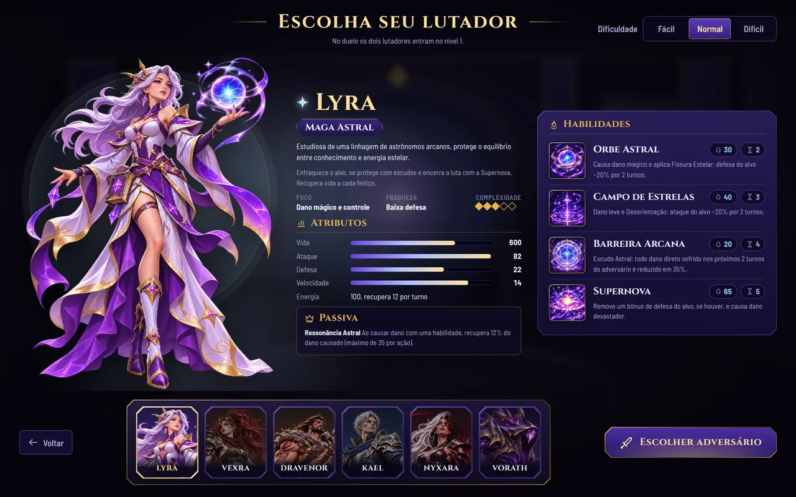

# Seleção de personagem e ícones de habilidade (3.6.0)

A tela de seleção foi refeita a partir dos conceitos aprovados. Ela mostra um lutador em destaque:

- **à esquerda**, a arte grande de corpo inteiro;
- **no centro**, o nome, a classe, a descrição, o perfil, os atributos e a passiva;
- **à direita**, as quatro habilidades;
- **embaixo**, uma faixa com os seis retratos para trocar de personagem.

Todos os textos e números vêm do código do jogo: descrição, atributos, passiva, custo e recarga. Nada foi copiado das fichas ilustradas.

O `BattleEngine`, a IA, as fórmulas, os atributos, os custos, as recargas, os sons e as coreografias de combate não mudaram.

## Como funciona

- **Troca de personagem.** Clicar num retrato troca na hora a arte, o nome, a classe, a descrição, os atributos, a passiva e as habilidades. As seis artes grandes são carregadas ao abrir a tela, então a troca não pisca.
- **Retrato selecionado.** Fica com moldura dourada e brilho; os outros ficam um pouco apagados.
- **Teclado.**
  - O retrato escolhido recebe o foco, com uma moldura clara bem visível.
  - As setas trocam de personagem; `Home` e `End` vão ao primeiro e ao último.
  - `Enter` confirma, e o duplo clique também confirma, como antes.
- **Vaelith** não aparece na faixa: ela continua sendo só a transformação da Nyxara em combate.
- **Adversário (Duelo).**
  - O mesmo layout, com o título "Escolha o adversário".
  - A opção **Aleatório** fica no fim da faixa e vem selecionada.
  - O **cenário** (Arena Arcana ou Ringue) aparece ao lado da dificuldade.
- **Desafio.** Os retratos mostram o nível de cada personagem, e o painel mostra a barra de experiência. Confirmar leva à tela do desafio.
- **Dificuldade.** Continua no topo, à direita.
- **Cor de destaque.** A luz ambiente, o círculo atrás da arte e a estrela do nome usam a cor do personagem escolhido (roxo da Lyra, laranja da Vexra, vermelho da Nyxara...).

### Tamanhos de tela

| Tela | Disposição |
| --- | --- |
| Desktop (acima de 1180 px) | Arte, informações e habilidades lado a lado, faixa de retratos embaixo, tudo sem rolar em 1920 × 1080, 1440 × 900 e 1280 × 800. Em telas Full HD, textos e ícones ficam maiores; em notebooks baixos, um pouco mais compactos. |
| Tablet (641–1180 px) | Arte e informações lado a lado, habilidades embaixo. A faixa de retratos fica logo abaixo do título. A arte acompanha a rolagem enquanto se lê o texto. |
| Celular (até 640 px) | Uma coluna: título, dificuldade, faixa de retratos (que rola na horizontal dentro dela, sem rolar a página), arte, informações e habilidades. O botão de confirmar fica preso ao pé da tela. |

### Diferenças intencionais em relação aos conceitos

| Conceito | No jogo | Motivo |
| --- | --- | --- |
| Arte da Lyra pintada para o mockup, com cenário e efeitos | Arte transparente atual de cada personagem, com luz e círculo arcano feitos em CSS | O pedido era não trocar a identidade dos personagens pelas variações dos mockups. Os cards têm texto e moldura e não podem ser recortados como arte limpa. |
| Textos e números inventados (Vida 520, "Chuva de Meteoros", "Sintonia Cósmica") | Textos e números reais do código | Os mockups são só para disposição; os valores do jogo vêm do TypeScript. |
| Ícones ilustrados das habilidades | Marcador provisório discreto: moldura dourada com um símbolo pelo tipo da habilidade | Os ícones finais ainda não foram produzidos. Não foram inventados nem recortados das fichas. |
| Logotipo "Arena RPG" no canto | Sem logotipo | O jogo não tem um logotipo como arquivo. Desenhar um imitando o mockup seria criar uma arte nova. |
| Ícones próprios em cada retrato (estrela, engrenagem...) | Só o nome | Esses símbolos não existem como arquivos no projeto. |
| Raio para o custo | Gota (o mesmo ícone de custo usado no combate) | Mantém a mesma linguagem visual do combate. |
| Perfil (foco, fraqueza, complexidade) e estilo de jogo | Mantidos no painel do meio | Já existiam na seleção anterior e ajudam a escolher. |

## Ícones das habilidades

> **Atualização (3.9.0):** os 27 ícones conceituais foram substituídos pelas ilustrações detalhadas (pintura digital), com os mesmos nomes e ids. Veja a seção "Ícones detalhados (3.9.0)" no fim deste documento.
>
> **Atualização (3.8.0):** os 27 ícones ilustrados (versão 1, conceitual) foram integrados. Todas as habilidades dos seis personagens e as três versões da Vaelith têm ícone. O botão bloqueado do Eclipse, durante a transformação, usa o ícone do Eclipse da Nyxara. O marcador provisório continua existindo para qualquer habilidade futura sem ícone.

A estrutura foi preparada na 3.6.0, quando ainda não havia ícones finais.

### Como adicionar

Coloque o arquivo em `src/assets/images/abilities/<pasta>/<id>.webp` (ou `.png`). O jogo encontra o arquivo sozinho no build, sem mudar código. Se um ícone faltar, aparece o marcador no lugar, e nada é bloqueado.

- **Formato:** quadrado, 512 × 512 (o padrão desde a 3.9.0), pintura de ponta a ponta, sem texto, sem retrato e sem moldura. O jogo acrescenta um único filete dourado fino.
- **Leitura:** precisa funcionar em 30 a 84 px.
- **Pasta:** é o personagem. As versões do Eclipse ficam em `vaelith/`, com os mesmos ids da Nyxara; o jogo escolhe a pasta pela forma ativa. Se a pasta da forma não tiver o ícone, usa o da forma base.

| Pasta | Ids |
| --- | --- |
| `lyra/` | `astral-orb`, `star-field`, `arcane-barrier`, `supernova` |
| `vexra/` | `piercing-burst`, `explosive-grenade`, `auto-turret`, `overload` |
| `dravenor/` | `devastating-blow`, `iron-skin`, `ancestral-fury`, `earth-rupture` |
| `kael/` | `arcane-blade`, `ethereal-step`, `perfect-duel`, `dimensional-cut` |
| `nyxara/` | `shadow-blade`, `abyss-mark`, `nyx-veil`, `eclipse` |
| `vaelith/` | `shadow-blade` (Lâmina Dilacerante), `abyss-mark` (Marca Profana), `nyx-veil` (Véu do Massacre), `eclipse` (botão "Vaelith no controle") |
| `vorath/` | `abyss-impact`, `assimilation`, `unstable-mass`, `void-rupture` |

O primeiro lote planejado é o da Lyra, descrito no brief: `lyra/astral-orb`, `lyra/star-field`, `lyra/arcane-barrier` e `lyra/supernova`.

### Onde aparecem

- **Seleção:** um ícone grande ao lado de cada habilidade, com nome, custo, recarga e descrição.
- **Combate:** um ícone à esquerda de cada botão de habilidade, com nome, custo e recarga.
  - Os estados indisponíveis (sem energia, em recarga, bloqueada) continuam iguais.
  - O painel de detalhes e os atalhos `1` a `4` também não mudaram.
  - Em notebooks de 1181 a 1400 px, os botões de habilidade passaram para duas linhas de dois, para o nome caber ao lado do ícone.

### Código

| Arquivo | Papel |
| --- | --- |
| `src/ui/abilityIcons.ts` | Mapa central por `ability.id`, pasta por forma, marcador provisório e o elemento do ícone. |
| `src/ui/screens/SelectScreen.ts` | Nova seleção. |
| `src/styles/screens.css` | Estilos da seleção. |
| `src/styles/base.css` | Estilo do ícone, compartilhado pela seleção e pelo combate. |
| `tests/abilityIcons.test.ts` | Confere a chave por forma, que todo arquivo de ícone corresponde a uma habilidade real e o marcador de cada tipo. |

## Verificação realizada

| Verificação | Resultado |
| --- | --- |
| `npm test` | 142 testes passando (4 novos sobre os ícones). |
| `npm run typecheck` e `npm run build` | Sem erros. |
| Capturas no navegador | Chrome sem interface com Playwright, build de produção. Seleção com os seis personagens em 1920 × 1080, 1440 × 900, 1280 × 800, 768 × 1024 e 390 × 844, e a escolha do adversário (Aleatório e Vorath). Desktop sem rolagem; nenhuma tela com rolagem horizontal. |
| Fluxos | Setas, `Home`, `End`, `Enter` e duplo clique. O passo do adversário vem com Aleatório selecionado e o cenário visível. O Ringue escolhido chega à luta. Desafio mostra níveis e experiência e leva à tela do desafio. |
| Ícones | Um arquivo de teste colocado temporariamente em `lyra/astral-orb` apareceu na seleção e no combate, e as outras habilidades ficaram com o marcador. O arquivo foi removido depois. |
| Combate | Nomes das habilidades cabem nos botões, sem quebrar palavras, de 360 a 1920 px. O roteiro completo das versões anteriores (menu, seleção, luta, Eclipse entrando e saindo, resultado em 5 tamanhos) passou sem erros. A sincronização dos sons continuou entre 0 e −10 ms. |

### Limitações

- Testado só no Chrome; Safari e Firefox não foram testados.
- Num celular com a tela deitada (paisagem baixa), a página rola na vertical, como antes.

## Ícones detalhados (3.9.0)

Os 27 ícones conceituais da 3.8.0 deram lugar às ilustrações detalhadas do pacote "Ícones Detalhados v4": 4 por personagem e 3 da Vaelith. Os nomes e os ids não mudaram, então nenhum código de mapeamento precisou mudar.

### Preparação dos arquivos

O pacote veio com tamanhos diferentes: 512 × 512 (Lyra e Dravenor) e 1024 × 1024 (os demais). Alguns ícones também traziam a arte como um quadro menor dentro da imagem. Para manter tamanho, enquadramento e leitura iguais:

- **Tamanho.** Todos foram padronizados em **512 × 512**, WebP com qualidade 88. Isso é mais que o suficiente para o maior uso, 84 px na seleção em telas grandes. O total caiu de cerca de 3 MB para cerca de 1,3 MB.
- **Bordas brancas.** O Kael (Lâmina Arcana) e o Eclipse da Nyxara vinham com a arte no meio de uma área branca. O corte foi automático, pela área não branca.
- **Arte num quadro menor.** Em Corte Dimensional, Duelo Perfeito, Passo Etéreo, Marca do Abismo, as três da Vaelith, Impacto do Abismo e Assimilação, o recorte foi para o quadro da arte. Assim o desenho ocupa o ícone inteiro e não aparece uma "moldura" pintada dentro da moldura do jogo.
- **Sem retoque.** Cores e detalhes não foram retocados: só houve recorte e redimensionamento.

Os arquivos do pacote, sem alteração, ficam em `assets-source/images/abilities/`. Lá também estão o manifesto e `ajustes.json`, com o recorte exato de cada ícone em pixels. Os PNG originais de alta resolução (cerca de 27 MB) não foram colocados no repositório.

### CSS

- **Moldura.** Antes, cada ilustração usava a moldura própria do desenho. Agora, como os novos ícones são pintura de ponta a ponta, o jogo coloca **um único filete dourado de 1 px** com cantos levemente arredondados (`.ability-icon--art`, em `base.css`). É uma moldura só, sem o chanfro do marcador provisório.
- **Botões e painéis.** O tamanho nos botões de combate (38 px no desktop, 34 a 40 px no celular) e na seleção (54 a 84 px) e a disposição dos painéis não mudaram.

### Nyxara e Vaelith

| Forma | Ícones usados |
| --- | --- |
| Normal | Os quatro da Nyxara. |
| Durante o Eclipse | Lâmina Dilacerante, Marca Profana e Véu do Massacre com os ícones da pasta `vaelith/`. O botão bloqueado do Eclipse continua com o ícone do Eclipse da Nyxara, porque não há um próprio da Vaelith. |
| Ao voltar | Os quatro da Nyxara de novo, automaticamente. |

Essa troca foi conferida no navegador pelos arquivos realmente carregados em cada momento: os quatro da Nyxara, depois os três da Vaelith mais o Eclipse da Nyxara, depois os quatro da Nyxara outra vez, no desktop e no celular.

### Verificação

| Verificação | Resultado |
| --- | --- |
| `npm test` | 147 testes passando, incluindo "todas as habilidades dos seis personagens e da Vaelith têm ícone". |
| `npm run typecheck` | Sem erros. |
| `npm run build` | Sem erros. O Vite gerou os **27** arquivos de ícone, com nomes com hash e nenhum caminho quebrado. |
| Navegador (Chrome com Playwright, build de produção) | Seleção e painel de combate dos seis personagens em 1440 × 900 e 390 × 844, com todos os ícones carregados. Transformação e retorno da Nyxara. Nomes das habilidades cabendo nos botões de 360 a 1920 px. Roteiro completo (menu, luta, Eclipse, resultado) sem erros e sem rolagem horizontal. |

### Limitações

- **Ícones escuros em tamanho pequeno.** Granada Explosiva, Torre Automática, Véu Espectral e Assimilação têm fundo escuro e ficam menos legíveis a 34–38 px do que os da Lyra e do Dravenor. As cores não foram mexidas, para preservar a arte; se quiser, dá para clarear só esses arquivos.
- **Botão do Eclipse durante a transformação.** Usa o ícone do Eclipse da Nyxara, porque o pacote não tem um próprio da Vaelith (comportamento esperado).
